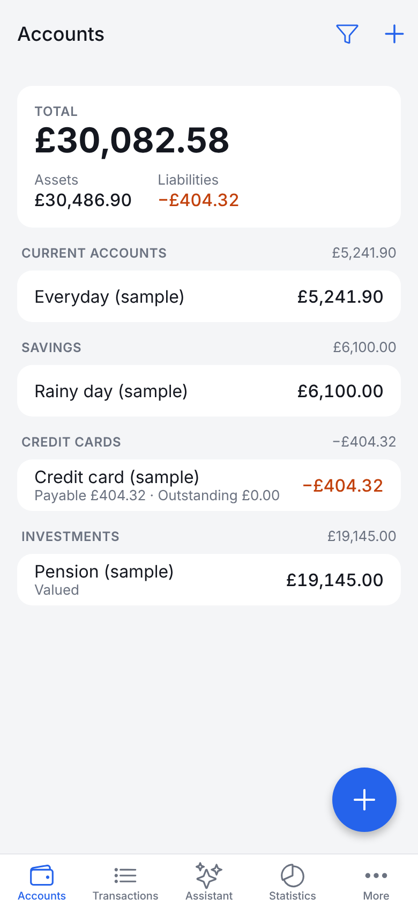
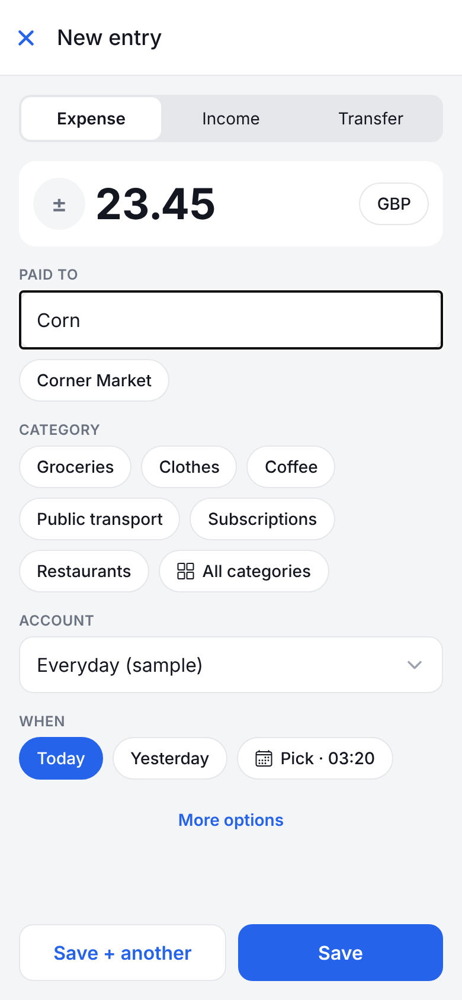
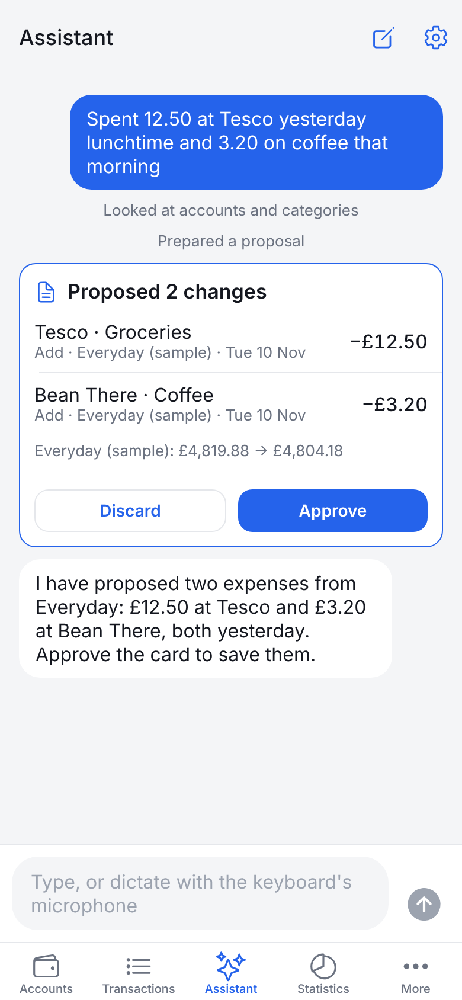
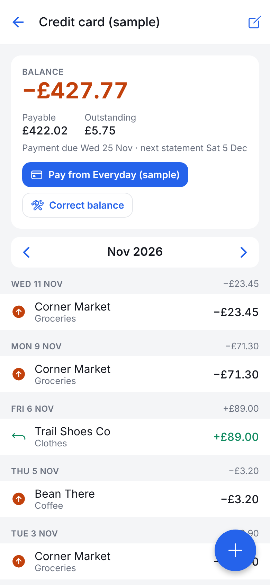
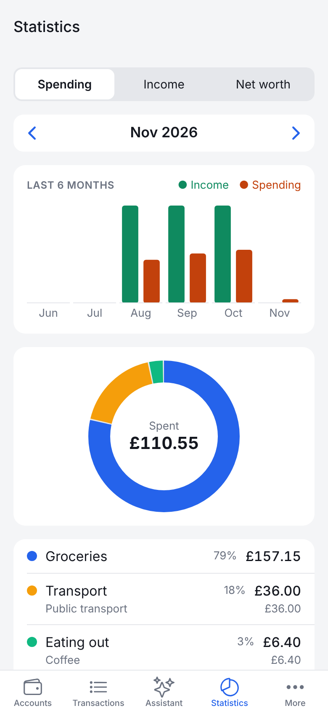
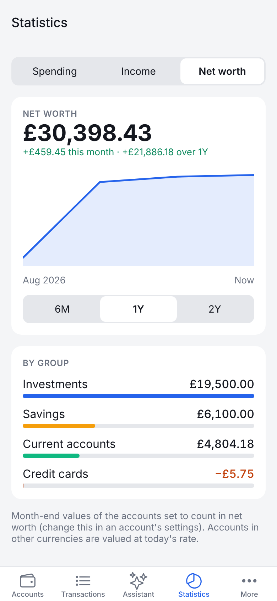

# pf-mobile

A personal finance ledger that lives entirely on your phone, with an optional AI assistant you talk to inside the app. Built with Expo (React Native), so it runs on iPhone and Android. There is no server and no account to create.

**Status: prototype.** Built in one session and checked in a browser and by automated tests. It has not yet been run on a real phone; see [What has and hasn't been checked](#what-has-and-hasnt-been-checked).

| Accounts | New entry | Assistant proposal |
|---|---|---|
|  |  |  |

| Credit card | Statistics | Net worth |
|---|---|---|
|  |  |  |

Screenshots show the built-in sample data, which is invented.

## What it does

- **Accounts** in groups you name, each Standard, Credit card or Valued (pensions, investments, property, loans). Saved account views with their own totals. Archive accounts you no longer use.
- **Transactions**: expenses, income and transfers between your accounts. Money back and refunds linked to the purchase. Payee suggestions that fill in the usual category and account. Search and filters. A recycle bin, and a change history for every entry.
- **Credit cards**: statement and due days, with what you owe split into Payable and Outstanding, and a Pay button.
- **Valued accounts**: record what something is worth from time to time; a change in value is never income or spending.
- **Other currencies**: pay in one currency from an account in another, at a saved rate, your own rate or the exact amount from your statement. Each entry keeps the rate it was saved with.
- **Bookmarks** (reusable starting points) and **repeating entries** (recorded automatically).
- **Statistics**: spending and income by category, month by month, and net worth over time.
- **Backup and restore** to a single file. Optional app lock (Face ID, fingerprint or passcode).
- **Assistant** (optional): describe what you spent, by typing or dictating, or ask questions about your money. It shows each change as a proposal; nothing is saved until you tap Approve.

Everything works without the assistant.

## Try it on your phone

You need a computer with [Node.js](https://nodejs.org) 20 or later, on the same Wi-Fi as the phone.

1. Install **Expo Go** on the phone from the App Store or Google Play.
2. On the computer:
   ```bash
   git clone -b claude/friendly-tesla-estbam https://github.com/Jordiejam/pf-mobile
   cd pf-mobile
   npm install
   npx expo start
   ```
3. Scan the QR code it prints: with the Camera app on iPhone, or from inside Expo Go on Android.
4. In the app, tap **Or load sample data** to explore with invented accounts, or **Add account** to start your own.

The app targets Expo SDK 58. If Expo Go says the project is incompatible, update Expo Go.

### Trying the assistant

Open **More, Assistant connection**. There are two ways to connect:

| | Sign in with ChatGPT | OpenAI API key |
|---|---|---|
| Paid by | Your ChatGPT Plus or Pro plan allowance | OpenAI, per use |
| Works in Expo Go | No | Yes |
| Needs | A development build (below) | A key from platform.openai.com |

**In Expo Go, use an API key.** Sign in with ChatGPT needs the app to listen on a local port during sign-in, which Expo Go cannot do.

To use Sign in with ChatGPT, make a development build, which is the app installed on its own rather than run inside Expo Go:

```bash
npx expo run:ios       # needs a Mac with Xcode
npx expo run:android   # needs Android Studio
```

or build in the cloud with [EAS](https://docs.expo.dev/develop/development-builds/create-a-build/). Installing on an iPhone needs an Apple developer account.

## Privacy

- The ledger is a SQLite file on the phone. Nothing is uploaded and there is no analytics.
- With the assistant, your message goes to OpenAI along with the ledger details needed to answer it: account and category names, balances and matching transactions. Nothing is sent when you are not using it.
- Sign-in tokens and API keys are kept in the phone's secure storage (Keychain or Keystore), not in the ledger or its backups.
- If daily reference exchange rates are on (the default), the app asks frankfurter.dev for European Central Bank rates. The request contains only currency codes. Turn it off under More, Exchange rates.
- Backup files are not encrypted. Keep them somewhere only you can reach.

**If the phone is lost without a backup, the ledger is lost.** Back up under More, Backup and data.

## What has and hasn't been checked

Checked:
- 49 automated tests of the ledger rules, the assistant's conversation loop and the sign-in flow (against stand-ins for OpenAI's servers).
- Every screen in a browser, including the assistant proposing and saving entries against a stand-in for OpenAI's API.
- The iPhone and Android app bundles compile.

Not checked:
- **Running on a real phone or in Expo Go.** Expect some rough edges in layout and keyboard handling.
- **Sign in with ChatGPT against OpenAI itself.** It follows OpenAI's documented flow for open-source apps and another open-source mobile app's working implementation, but it has not been run against the real service, and OpenAI has not confirmed that mobile apps qualify.
- **The assistant against a real model.** How well it interprets messy descriptions is untested.
- Reference exchange rate fetching against the real provider.

## Not built yet

- Importing from Money Manager or other apps.
- Receipt and file attachments.
- Transfers between accounts in different currencies.
- One payment that refunds several purchases (a refund links to one purchase).
- Budgets and split transactions (deliberately left out for now).
- Sync between devices, or sharing a ledger with someone else.
- Editing a repeating entry's amount or schedule (delete it and make a new one).
- Reordering groups, categories and views.
- Keeping the assistant conversation after the app is closed.
- Voice input beyond the keyboard's dictation button.
- A browser version. The browser build is a development preview that forgets everything on reload.

## Development

```bash
npm test            # ledger and assistant tests (Node 22+)
npm run typecheck
```

```
src/core/       The ledger: money, accounts, transactions, cards, valuations, rates, reports, backup.
                Plain TypeScript over a small SQLite interface; no React or Expo imports.
src/assistant/  The assistant: tools, conversation loop, model client, Sign in with ChatGPT.
src/platform/   What the phone provides: the database file, secure storage, sign-in browser, files.
src/ui/         Shared components.
src/app/        Screens (Expo Router).
tests/          Run against Node's built-in SQLite.
```

See [AGENTS.md](AGENTS.md) for the engineering principles and [docs/decisions.md](docs/decisions.md) for what has been decided and why.

## Licence

Apache 2.0. See [LICENSE](LICENSE).
